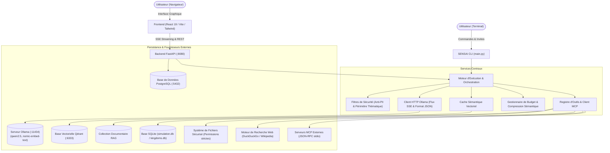

# SENSAI — Assistant IA Modulaire et Agentique

## 1. Contexte et Univers Pédagogique

SENSAI s'inscrit dans le cadre historique de la Chine antique durant la période des Sept Royaumes Combattants (*Zhanguo*, 475 av. J.-C. – 221 av. J.-C.) : Qin, Chu, Qi, Zhao, Wei, Han et Yan.

Le système propose deux modes opératoires distincts :
1. **Mode Encyclopédie (`/encyclopedia`)** : Analyse géopolitique, exploration des figures historiques (*Qin Shi Huang*, *Li Mu*, *Bai Qi*) et des traités stratégiques (*L'Art de la Guerre* de Sun Tzu). Ce mode s'appuie sur une recherche documentaire RAG (Retrieval-Augmented Generation) indexant les chroniques antiques (*Shiji*, *Zhan Guo Ce*) couplée à une recherche Web dynamique.
2. **Mode Simulation Tactique (`/simulation`)** : Moteur de simulation d'affrontements militaires au tour par tour. L'état des forces armées, des ressources et du moral est maintenu dans une base de données relationnelle SQLite. L'évaluation des ordres repose sur l'ancrage factuel, la détection d'incohérences et une confirmation humaine obligatoire (Human-in-the-Loop) avant toute écriture de rapport ou modification d'état.

---

## 2. Architecture Technique



---

## 3. Matrice des Fonctionnalités Implémentées

Le système implémente l'ensemble des modules requis par le référentiel d'évaluation. Les critères d'acceptation détaillés sont formalisés dans le fichier [`USER_STORIES.md`](USER_STORIES.md).

| Identifiant | Domaine | Intitulé | Description technique |
|:---:|:---|:---|:---|
| **[B1]** | Socle | Chatbot CLI Fonctionnel | Interface console avec restitution des tokens en streaming progressif, maintien de l'historique de session, reprise sur erreur réseau et sélection dynamique du modèle. |
| **[M1]** | Mémoire | Persistance de Session & Profils | Sauvegarde et rechargement des conversations au format JSON, injection automatique de profils utilisateurs persistants, interopérabilité complète entre la CLI et le Web. |
| **[M2]** | Mémoire | Budget de Tokens & Compression Sémantique | Suivi de la consommation des tokens et déclenchement d'un résumé automatique par fenêtre glissante lors du dépassement du plafond contextuel. |
| **[M3]** | Mémoire | Mémoire Externe Structurée | Persistance des données économiques et militaires des sept royaumes sous SQLite. Lecture et mise à jour pilotées par l'agent, avec réinitialisation d'état après chaque bataille. |
| **[M4]** | Mémoire | Document Vivant d'État (Artefact) | Maintien d'un livrable d'état distinct de l'historique conversationnel, mis à jour de manière incrémentale par l'outil `update_artifact`. |
| **[T1]** | Outils | Model Context Protocol (MCP) | Intégration du protocole standard MCP via transport stdio, enregistrement dynamique d'outils distants et serveur de démonstration logistique inclus. |
| **[T3]** | Outils | Recherche Web en Direct | Requêtage synchrone via DuckDuckGo et Wikipédia sans clé d'API propriétaire, synthèse des données et restitution des URLs sources. |
| **[T4]** | Outils | Accès Système de Fichiers Sécurisé | Lecture et écriture restreintes au répertoire `battle_reports/`, contrôle strict des extensions, interdiction du path traversal et journalisation des accès. |
| **[T5]** | Outils | Sorties Structurées | Génération de payloads JSON stricts validés par schémas Pydantic (`KingdomInfo`, `HistoricalFigure`, `StructuredResponse`) avec boucle de correction automatique en cas d'erreur de syntaxe. |
| **[R1]** | RAG | Recherche Documentaire Vectorielle | Pipeline d'ingestion et découpage de chroniques historiques, génération d'embeddings `nomic-embed-text` stockés dans Qdrant, et bascule automatique vers le Web en cas de couverture insuffisante. |
| **[A3]** | Agentique | Validation Humaine (Human-in-the-Loop) | Suspension de l'agent avant l'exécution d'opérations critiques ou destructrices, soumission du plan d'action et attente d'une validation explicite (`[Y/N]` en CLI, modal graphique en Web). |
| **[A4]** | Agentique | Versionnage de Prompts | Moteur de gestion de versions des instructions système : calcul de hash SHA-256, horodatage, consultation de diffs unifiés et restauration instantanée (`rollback`). |
| **[A5]** | Agentique | Personas Dynamiques | Bascule instantanée de la personnalité de l'agent (Scribe, Général, Érudit diplomate) sans réinitialisation du contexte conversationnel. |
| **[A6]** | Agentique | Cache Sémantique | Interception des requêtes récurrentes via calcul de similarité cosinus dans Qdrant, servant la réponse en moins de 50 millisecondes sans solliciter le LLM. |
| **[EV1]**| Évaluation | Détection des Hallucinations | Vérification de la cohérence historique et vérification de la conformité des récits militaires par rapport aux données brutes issues de la simulation (`check_narration`). |
| **[EV2]**| Évaluation | Filtres de Sécurité & Confidentialité | Blocage strict des requêtes sortant du cadre thématique et anonymisation automatique des données personnelles (PII : courriels, numéros de téléphone) à l'entrée et à la sortie. |
| **[X1]** | Interface | Interface Web Graphique | Application web découplée en React 19, TypeScript et Tailwind CSS, intégrant le streaming SSE, la gestion multi-sessions et la surveillance des métriques. |
| **[X2]** | Interface | Gestion des Branches & Interruption | Possibilité d'éditer un message antérieur pour créer une branche narrative alternative et arrêt immédiat du streaming par interruption de l'utilisateur. |
| **[X3]** | Interface | Export & Publication | Exportation des échanges et des artefacts d'état aux formats Markdown et PDF prêts à la diffusion, purgés des métadonnées techniques. |
| **[X4]** | Interface | Formulaires Interactifs | Outil `ask_user_form` permettant au modèle de collecter des variables structurées via un formulaire pas à pas en console ou un formulaire visuel sur le Web. |

---

## 4. Prérequis Système

- **Système d'exploitation** : Linux (testé sous Ubuntu 22.04 et 24.04), macOS ou Windows sous sous-système WSL2.
- **Python** : Version 3.11 recommandée (version 3.10 minimale requise).
- **Node.js** : Version 20.x ou supérieure, avec le gestionnaire de paquets `npm`.
- **Docker & Docker Compose** : Nécessaires à l'orchestration des bases PostgreSQL et Qdrant.
- **Ollama** : Installé localement et accessible à l'adresse `http://localhost:11434`.

---

## 5. Procédure d'Installation

### 5.1. Clonage du Répertoire

```bash
git clone git@github.com:EpitechPGE3-2026/G-AIA-500-LIL-5-1-sensai-8.git
cd G-AIA-500-LIL-5-1-sensai-8
```

### 5.2. Configuration de l'Environnement

Initialisez le fichier des variables d'environnement à partir du modèle fourni :

```bash
cp .env.example .env
```

Le fichier `.env` définit les paramètres suivants :
- Accès PostgreSQL (`POSTGRES_USER`, `POSTGRES_PASSWORD`, `POSTGRES_DB`, `POSTGRES_PORT=5432`)
- Coordonnées de l'API Ollama (`OLLAMA_BASE_URL=http://localhost:11434`)
- Coordonnées de la base Qdrant (`QDRANT_HOST=localhost`, `QDRANT_PORT=6333`)
- Ports d'écoute des services applicatifs (Backend: `8080`, Frontend: `3000`)

### 5.3. Téléchargement des Modèles Ollama

Assurez-vous que le service Ollama est démarré, puis procédez au téléchargement des modèles nécessaires :

```bash
# Modèle d'instruction et de raisonnement
ollama pull qwen2.5:3b

# Modèle d'embeddings vectoriels (requis pour le RAG et le cache sémantique)
ollama pull nomic-embed-text
```

### 5.4. Déploiement des Services d'Infrastructure

Lancez les conteneurs PostgreSQL et Qdrant via Docker Compose :

```bash
docker compose up -d bdd qdrant
```

Vérifiez la disponibilité des points de terminaison :
- PostgreSQL : port local `5432`
- Qdrant REST API : `http://localhost:6333/dashboard`

### 5.5. Configuration de l'Environnement Virtuel Python

```bash
# Création et activation de l'environnement virtuel
python3 -m venv .venv
source .venv/bin/activate

# Installation des dépendances du CLI et du Backend
pip install --upgrade pip
pip install -r requirements.txt -r backend/requirements.txt
```

### 5.6. Indexation Vectorielle Initiale (RAG)

Pour peupler la base vectorielle avec les chroniques des Sept Royaumes, exécutez le script d'ingestion :

```bash
python -m src.RAG.RAG_embedding
```

Ce script segmente les documents textuels situés dans `src/RAG`, génère les vecteurs denses via `nomic-embed-text` ainsi que les représentations lexicales BM25, puis crée la collection `royaumes_combattants` dans Qdrant.

### 5.7. Installation des Dépendances Frontend

```bash
cd frontend
npm install
cd ..
```

---

## 6. Guide d'Exécution

### 6.1. Exécution de la Console Interactive (CLI)

La CLI constitue l'interface principale d'administration et d'expérimentation locale.

```bash
# Lancement standard
python -m src.interfaces.cli.main

# Lancement avec prise en charge des outils d'agent
python -m src.interfaces.cli.main --tools

# Lancement avec sélection explicite d'un modèle et d'un profil
python -m src.interfaces.cli.main -m qwen2.5:3b --profile historien --tools

# Lancement en mode débogage (affichage des logs d'orchestration)
python -m src.interfaces.cli.main --debug
```

#### Répertoire des Commandes de la Console

| Commande | Action | Exemple d'utilisation |
|:---|:---|:---|
| `/help` | Affiche l'inventaire exhaustif des commandes | `/help` |
| `/simulation` | Active le mode simulation tactique de batailles | `/simulation` |
| `/encyclopedia` | Active le mode encyclopédie historique et lore | `/encyclopedia` |
| `/tools [on\|off]` | Active ou désactive les appels d'outils du modèle | `/tools on` |
| `/mcp status` | Affiche l'état du serveur MCP connecté | `/mcp status` |
| `/mcp connect <cmd>` | Établit la connexion avec un serveur MCP externe | `/mcp connect python -m src.features.tools.mcp_server_demo` |
| `/mcp disconnect` | Ferme la session avec le serveur MCP en cours | `/mcp disconnect` |
| `/session list` | Énumère l'ensemble des sessions enregistrées | `/session list` |
| `/session new [titre]` | Initialise une nouvelle session de discussion | `/session new Campagne_Changping` |
| `/session load <id>` | Restaure l'historique d'une session existante | `/session load 6c91a8ec` |
| `/session delete <id>`| Supprime définitivement une session du stockage | `/session delete 6c91a8ec` |
| `/profile show` | Présente les caractéristiques du profil actif | `/profile show` |
| `/profile load <nom>` | Charge un profil utilisateur enregistré | `/profile load strategiste` |
| `/persona [nom]` | Bascule le rôle de l'agent sans perte d'historique | `/persona scribe_qin` |
| `/prompt versions <nom>` | Consulte l'historique des versions d'un prompt | `/prompt versions scribe_qin` |
| `/prompt diff <nom> <v1> <v2>` | Génère le diff unifié entre deux versions | `/prompt diff scribe_qin v1 v2` |
| `/prompt rollback <nom> <v>` | Rétablit une version antérieure d'un prompt | `/prompt rollback scribe_qin v1` |
| `/kingdom <nom>` | Extrait la fiche d'un royaume en JSON strict | `/kingdom Qin` |
| `/figure <nom>` | Extrait la biographie d'un personnage en JSON strict | `/figure Qin Shi Huang` |
| `/structured-output [on\|off]` | Active le filtrage des réponses en JSON pur | `/structured-output on` |
| `/rag [on\|off]` | Active ou suspend l'enrichissement documentaire | `/rag on` |
| `/budget` | Restitue la consommation cumulée des tokens | `/budget` |
| `/clear-cache` | Réinitialise l'intégralité du cache sémantique | `/clear-cache` |
| `/artifact [save <path>]` | Consulte ou exporte l'artefact de travail | `/artifact save battle_reports/bilan.md` |
| `/export [pdf\|md] [path]` | Exporte la conversation en Markdown ou en PDF | `/export pdf exports/session.pdf` |
| `/clear` | Réinitialise l'historique de la session en cours | `/clear` |
| `/exit` | Termine proprement l'exécution de la console | `/exit` |

---

### 6.2. Exécution de la Plateforme Web

#### Déploiement Conteneurisé (Production)

L'ensemble des services (PostgreSQL, Qdrant, Backend FastAPI et Frontend React) peut être instancié en une commande :

```bash
docker compose up --build
```

- Interface utilisateur : `http://localhost:3000`
- API Backend : `http://localhost:8080` (documentation interactive OpenAPI : `http://localhost:8080/docs`)

#### Déploiement Local (Développement)

Pour une utilisation avec rechargement automatique à chaud des modifications :

```bash
# Terminal 1 — Serveur d'API Backend
source .venv/bin/activate
uvicorn backend.main:app --host 0.0.0.0 --port 8080 --reload

# Terminal 2 — Serveur de Développement Frontend
cd frontend
npm run dev
```

L'application web est alors accessible sur `http://localhost:5173`.

---

### 6.3. Serveur de Démonstration MCP

Le projet embarque un serveur MCP standard implémentant le protocole JSON-RPC sur les flux d'entrée/sortie standard. Il expose deux fonctions :
- `calculate_grain_supply` : modélisation de la consommation logistique de grains pour une armée en campagne.
- `get_historical_battle` : consultation des archives des batailles majeures de la période.

Lancement unitaire :
```bash
python -m src.features.tools.mcp_server_demo
```

Connexion depuis la console interactive SENSAI :
```bash
/mcp connect python -m src.features.tools.mcp_server_demo
```

---

## 7. Tests et Validation de la Qualité de Code

Le système est validé par une suite de tests unitaires, d'intégration et de scénarios de bout en bout (E2E), garantissant l'intégrité de l'orchestration et la non-régression.

```bash
# Validation de la compilation du bytecode et de la syntaxe
python -m compileall -q backend src tests scripts

# Exécution de la suite de tests Pytest (247 tests)
PYTHONPATH=. pytest -v --durations=10

# Exécution du test d'intégration de bout en bout (CLI E2E)
PYTHONPATH=. python scripts/test_cli_e2e.py

# Validation statique et compilation du Frontend
cd frontend
npm run lint
npm run build
```

---

## 8. Organisation du Répertoire

```text
sensai/
├── backend/                  # API REST, streaming SSE et WebSockets (FastAPI)
│   ├── routes/               # Contrôleurs : authentification, conversations, modèles, MCP, personas
│   ├── database.py           # Définitions SQLAlchemy et connexion PostgreSQL
│   ├── tools_registry.py     # Passerelle d'exposition des outils au backend web
│   └── Dockerfile            # Spécification de construction de l'image backend
├── battle_reports/           # Espace de stockage restreint pour les rapports militaires [T4]
├── config.json               # Fichier de configuration par défaut du moteur
├── docker-compose.yml        # Définition des services d'infrastructure et d'application
├── frontend/                 # Application monopage React 19 / TypeScript / Vite / Tailwind v4
│   ├── src/components/       # Composants d'interface (Console, Formulaires, Cartes de validation)
│   └── src/types/            # Déclarations des interfaces TypeScript
├── kingdom_manuscript/       # Documentation historique relative aux factions
├── manuscrit_royaumes/       # Répertoire documentaire soumis au contrôle d'accès [T4]
├── personnalites/            # Fichiers de configuration des personas déclarées [A5]
├── scripts/                  # Scripts de validation automatisée (test_cli_e2e.py)
├── src/                      # Noyau applicatif SENSAI (aucun framework externe)
│   ├── core/                 # Client Ollama, moteur d'événements, cache sémantique, budget tokens
│   ├── features/             # Modules métier
│   │   ├── memory/           # Gestion des sessions, profils et artefacts d'état [M1, M4]
│   │   ├── prompt/           # Moteur de personas et de versionnage des prompts [A4, A5]
│   │   ├── sec/              # Guardrails d'entrée/sortie, filtrage PII et contrôle d'accès [EV2, T4]
│   │   ├── simulation/       # Moteur d'affrontements tactiques, store SQLite, règles de Sun Tzu [M3]
│   │   └── tools/            # Registre d'outils, client MCP, recherche web, formulaires [T1, T3, X4]
│   ├── interfaces/cli/       # Implémentation de la console terminale [B1]
│   └── RAG/                  # Moteur d'ingestion vectorielle et de recherche documentaire [R1]
├── tests/                    # Ensemble des suites de tests automatisés Pytest
└── USER_STORIES.md           # Spécifications fonctionnelles et critères d'acceptation
```