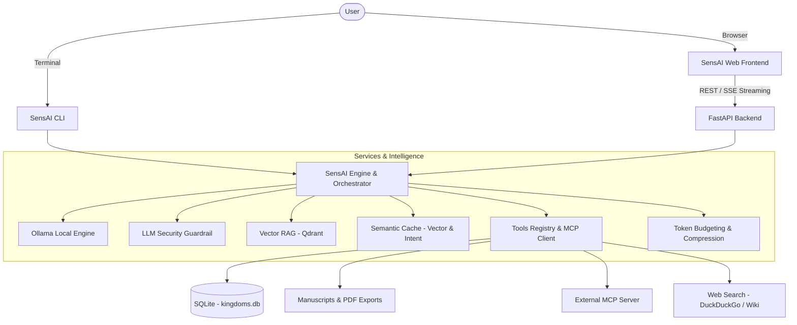

# SensAI — Documentation & Architecture

> Modular, agentic, and sovereign AI assistant inspired by the 7 Warring States of Ancient China.

SensAI is a complete artificial intelligence system combining a reactive CLI engine for historical exploration and tactical battle simulation, a high-performance asynchronous FastAPI backend, and a modern web interface built with React 19 and shadcn/ui.

---

## Project Overview

SensAI is designed around 6 major architectural pillars:



### Core Subsystems

1. **SensAI CLI ([docs/en/cli.md](file:///e:/Dev/sensai/docs/en/cli.md))**: Interactive command-line interface with real-time token streaming, instant switching between Encyclopedia and turn-based Battle Simulation modes, and proactive RAG document enrichment.
2. **SensAI Frontend ([docs/en/frontend.md](file:///e:/Dev/sensai/docs/en/frontend.md))**: Clean web interface featuring a Dark Obsidian design (inspired by Linear.app / Dub.co), built with React 19, Tailwind CSS v4, and shadcn/ui.
3. **Frontend & Backend Architecture ([docs/en/frontend-architecture.md](file:///e:/Dev/sensai/docs/en/frontend-architecture.md))**: SSE / NDJSON streaming protocols, dynamic interactive forms (`ask_user_form`), Human-in-the-loop confirmation for sensitive actions, and real-time token budget tracking.
4. **Tool System & MCP ([docs/en/tools-guide.md](file:///e:/Dev/sensai/docs/en/tools-guide.md))**: Extensible tool registry using the `@tool` decorator, native Model Context Protocol (MCP) client/server integration, and permission validation.
5. **Vector RAG & Semantic Cache ([docs/en/rag-and-cache.md](file:///e:/Dev/sensai/docs/en/rag-and-cache.md))**: Hybrid search across ancient chronicles (*Shiji*, *Zhan Guo Ce*), `nomic-embed-text` dense embeddings, and two-tier semantic caching.
6. **Contributor Guide ([docs/en/contributing.md](file:///e:/Dev/sensai/docs/en/contributing.md))**: Code standards, PR lifecycle, unit testing, and continuous integration.

---

## Quickstart

### Prerequisites

- **Python 3.11+** with a virtual environment (`venv`).
- **Ollama** running locally (`http://localhost:11434`) with the following models:
  - `qwen2.5:7b` (or `qwen2.5:3b`) for generation and agent workflows.
  - `nomic-embed-text` for RAG vectorization and semantic caching.
- **Docker & Docker Compose** to run PostgreSQL and Qdrant.
- **Node.js 22+ & npm** for the frontend interface and documentation website.

### Starting with Docker Compose

```bash
# Start PostgreSQL database and Qdrant vector store
docker compose up -d bdd qdrant
```

### Running the CLI

```bash
# Activate your virtual environment
source venv/bin/activate  # or .\venv\Scripts\activate on Windows

# Launch the agent in terminal mode
python -m src.interfaces.cli.main -m qwen2.5:7b
```

### Running the Web Application

```bash
# Terminal 1: FastAPI Backend
python -m uvicorn backend.main:app --host 0.0.0.0 --port 8080 --reload

# Terminal 2: React Frontend
cd frontend
npm install
npm run dev
```

The web app is accessible at `http://localhost:5173`.
