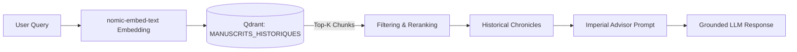
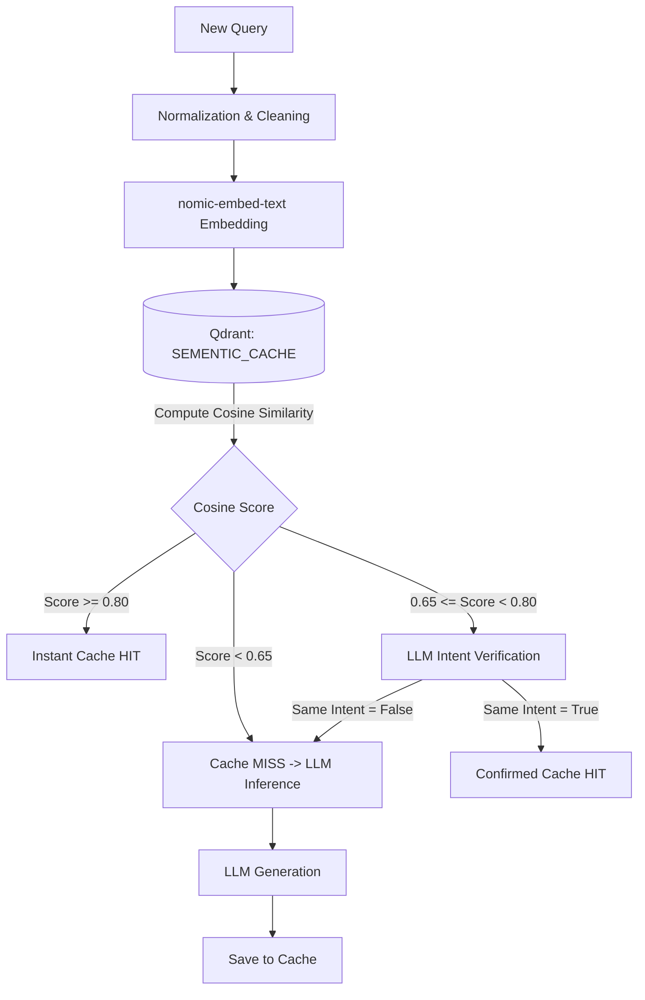

# Vector RAG & Semantic Cache

SensAI incorporates two high-performance vector subsystems powered by the **Qdrant** vector database and the local **`nomic-embed-text`** embedding model.

---

## Vector RAG (Retrieval-Augmented Generation)

RAG grounds agent reasoning in authentic historical records from the Warring States period:
- **Shiji (Records of the Grand Historian)** by Sima Qian.
- **Zhan Guo Ce (Strategies of the Warring States)** (Qin Ce, Qi Ce, Chu Ce, Zhao Ce, Wei Ce, Han Ce, Yan Ce).
- **The Art of War** by Sun Tzu.



### 1. Ingestion & Vectorization (`src/RAG/RAG_embedding.py`)

Chronicles are split into semantic chunks with overlapping boundaries to preserve narrative coherence:
- Embedding size: **768 dimensions**.
- Distance metric: **Cosine**.
- Metadata attached to each point: chapter name, kingdom, historical figures, and section index.

To initialize or refresh the local vector store:

```bash
python -m src.RAG.RAG_embedding
```

### 2. Hybrid Search & Fallback (`src/RAG/retriever.py`)

During query execution:
1. **Entity Extraction:** Identifies kingdoms and figures in the prompt.
2. **Dense Search:** Cosine similarity retrieval over dense embeddings.
3. **Keyword / Sparse Search:** Exact-match filtering for ancient proper nouns.
4. **Web Fallback:** If fewer than two local sources match, the retriever triggers a complementary web search.

---

## Semantic Cache (`src/core/sementic_cache.py`)

The semantic cache bypasses LLM inference for redundant or rephrased queries, cutting response latency to under **15 milliseconds**.

### Multi-Tier Architecture



### 1. Prompt Normalization (`normalize_prompt`)
Strips conversational filler and polite phrasing (*"can you please tell me about"*, *"explain to me"*) to compare queries by their core semantic intent.

### 2. High Threshold Immediate Validation (`seuil_haut = 0.80`)
If cosine proximity between the cached question and the incoming question exceeds 0.80, the cached response is served immediately with the indicator `from_cache: true`.

### 3. Lower Tier & Intent Equivalence (`seuil_bas = 0.65`)
For questions within the 0.65–0.80 range, a lightweight LLM sub-call validates strict equivalence in JSON format:

```json
{"same_intent": true}
```
