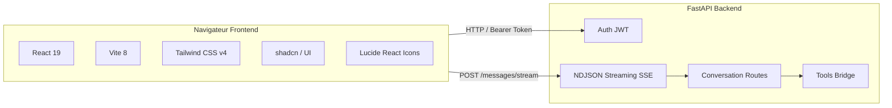

# SensAI Frontend — Présentation & Design

L'interface web de SensAI offre un cockpit moderne, fluide et réactif pour dialoguer avec les modèles d'intelligence artificielle locaux, administrer les outils MCP et suivre l'état de la mémoire conversationnelle.

---

## Direction Artistique & Design System

L'interface utilisateur de SensAI adopte une direction artistique sobre, technique et haut de gamme, fortement inspirée des standards de **Linear.app** et **Dub.co** :

- **Palette Dark Obsidian :** Arrière-plans profonds (`#09090b` / `#0c0d0e`), surfaces surélevées subtiles (`#121316` / `#16181d`), et bordures fines et nettes (`border-border` / `border-zinc-800`).
- **Précision Typographique :** Stack de polices sans-serif native à haute densité d'information, alignements géométriques stricts et micro-détails soignés.
- **Micro-interactions Maîtrisées :** Rayons de courbure maîtrisés (`rounded-md` / `rounded-lg`, ~6-8px), absence d'ombres lourdes, de dégradés kitsch ou d'animations excessives.
- **Composants shadcn/ui :** Exploitation intégrale des primitives d'accessibilité de `@base-ui/react` et des composants stylisés avec Tailwind CSS v4.

---

## Stack Technique

| Composant | Technologie | Version / Détails |
| :--- | :--- | :--- |
| **Framework UI** | React | `^19.2.8` |
| **Build & Bundler** | Vite | `^8.3.0` |
| **Styling** | Tailwind CSS v4 | `@tailwindcss/vite ^4.3.3` |
| **Composants** | shadcn/ui & Base UI | `@base-ui/react ^1.8.0`, `shadcn ^4.21.3` |
| **Icônes** | Lucide React | `^1.52.0` |
| **Linter** | Oxlint | `^1.81.0` (ultra-rapide en Rust) |

---

## Fonctionnalités Clés de l'Interface

1. **Streaming fluide des réponses (SSE / NDJSON) :** Les tokens générés par Ollama s'affichent mot à mot sans blocage de l'interface, avec détection automatique de la fin du flux.
2. **Gestionnaire de Modèles :** Sélection dynamique du modèle d'inférence (ex: `qwen2.5:7b`, `qwen2.5:3b`, `llama3:8b`) avec persistance par utilisateur.
3. **Sélecteur d'Outils Modulaire :** Menu popover permettant d'activer à la volée les outils disponibles :
   - *Structured Output* (réponse stricte au format JSON).
   - *Recherche Web en direct* (DuckDuckGo / Wikipedia).
   - *Génération de documents PDF* professionnels.
   - *Outils externes connectés via MCP (Model Context Protocol)*.
4. **Formulaires Interactifs Inline (`sensai-form`) :** Lorsque l'IA a besoin de précisions complémentaires, elle émet un bloc interactif avec champs de formulaire (textes, nombres, listes déroulantes) que l'utilisateur remplit directement dans le fil de discussion.
5. **Confirmation des Actions Sensibles (`sensai-confirm`) :** Pour les opérations destructives (écriture de fichier sur le disque ou altération de la base de données), l'interface présente un dialogue de confirmation explicite avec token d'approbation à usage unique.
6. **Compteur de Contexte & Budget de Tokens :** Affichage en temps réel du coût de la requête (tokens de prompt, tokens de complétion et total cumulé).
