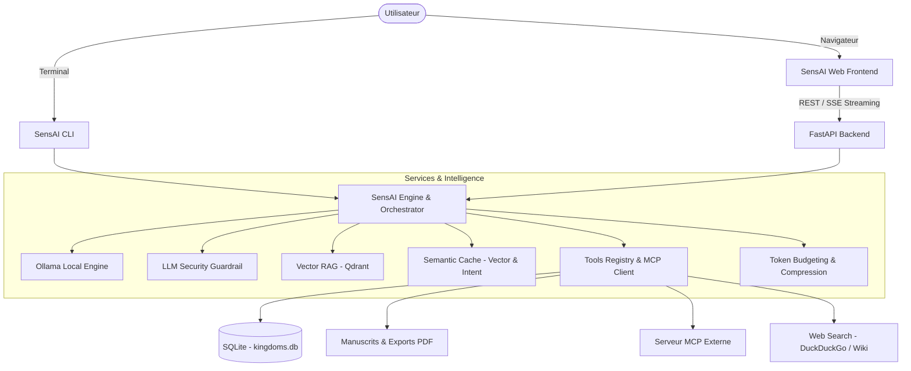

> Assistant IA modulaire, agentique et souverain, inspiré de l'époque des Sept Royaumes Combattants de la Chine antique.

SensAI est un système d'intelligence artificielle complet combinant un moteur CLI réactif pour l'exploration historique et la simulation tactique, un backend asynchrone FastAPI à haute performance, et une interface web moderne sous React 19 et shadcn/ui.

---

## 🏛️ Vue d'ensemble du projet

SensAI est conçu autour de 6 piliers architecturaux majeurs :



### Principaux sous-systèmes

1. **SensAI CLI ([docs/cli.md](file:///e:/Dev/sensai/docs/cli.md))** : Interface en ligne de commande interactive avec streaming temps-réel, bascule instantanée entre le mode Encyclopédie et le mode Simulation de guerre au tour par tour, et enrichissement documentaire RAG proactif.
2. **SensAI Frontend ([docs/frontend.md](file:///e:/Dev/sensai/docs/frontend.md))** : Interface web épurée au design Dark Obsidian (inspirée de Linear.app / Dub.co), développée avec React 19, Tailwind CSS v4 et shadcn/ui.
3. **Architecture Frontend & Backend ([docs/frontend-architecture.md](file:///e:/Dev/sensai/docs/frontend-architecture.md))** : Protocole de streaming SSE / NDJSON, formulaires dynamiques interactifs (`ask_user_form`), confirmation d'actions destructives (Human-in-the-loop) et suivi en direct de la consommation de tokens.
4. **Système d'Outils & MCP ([docs/tools-guide.md](file:///e:/Dev/sensai/docs/tools-guide.md))** : Registre d'outils extensible via décorateur `@tool`, intégration Model Context Protocol (MCP) et validation de permissions.
5. **RAG Vectoriel & Cache Sémantique ([docs/rag-and-cache.md](file:///e:/Dev/sensai/docs/rag-and-cache.md))** : Recherche hybride dans les chroniques antiques (*Shiji*, *Zhan Guo Ce*), embeddings denses `nomic-embed-text`, et cache sémantique multi-niveaux.
6. **Guide du Contributeur ([docs/contributing.md](file:///e:/Dev/sensai/docs/contributing.md))** : Conventions de code, cycle de vie des PRs, tests unitaires et intégration continue.

---

## 🚀 Démarrage Rapide

### Prérequis

- **Python 3.11+** avec environnement virtuel (`venv`).
- **Ollama** en fonctionnement local (`http://localhost:11434`) avec les modèles :
  - `qwen2.5:7b` (ou `qwen2.5:3b`) pour la génération et le rôle d'agent.
  - `nomic-embed-text` pour la vectorisation RAG et le cache sémantique.
- **Docker & Docker Compose** pour exécuter les services PostgreSQL et Qdrant.
- **Node.js 22+ & npm** pour l'interface frontend et la documentation.

### Lancement avec Docker Compose

```bash
# Démarrage de la base PostgreSQL et de la base vectorielle Qdrant
docker compose up -d bdd qdrant
```

### Lancement du CLI

```bash
# Activation de l'environnement virtuel
source venv/bin/activate  # ou .\venv\Scripts\activate sous Windows

# Lancement de l'agent en ligne de commande
python -m src.interfaces.cli.main -m qwen2.5:7b
```

### Lancement de l'Application Web

```bash
# Terminal 1 : Backend FastAPI
python -m uvicorn backend.main:app --host 0.0.0.0 --port 8080 --reload

# Terminal 2 : Frontend React
cd frontend
npm install
npm run dev
```

L'application web est accessible sur `http://localhost:5173`.
