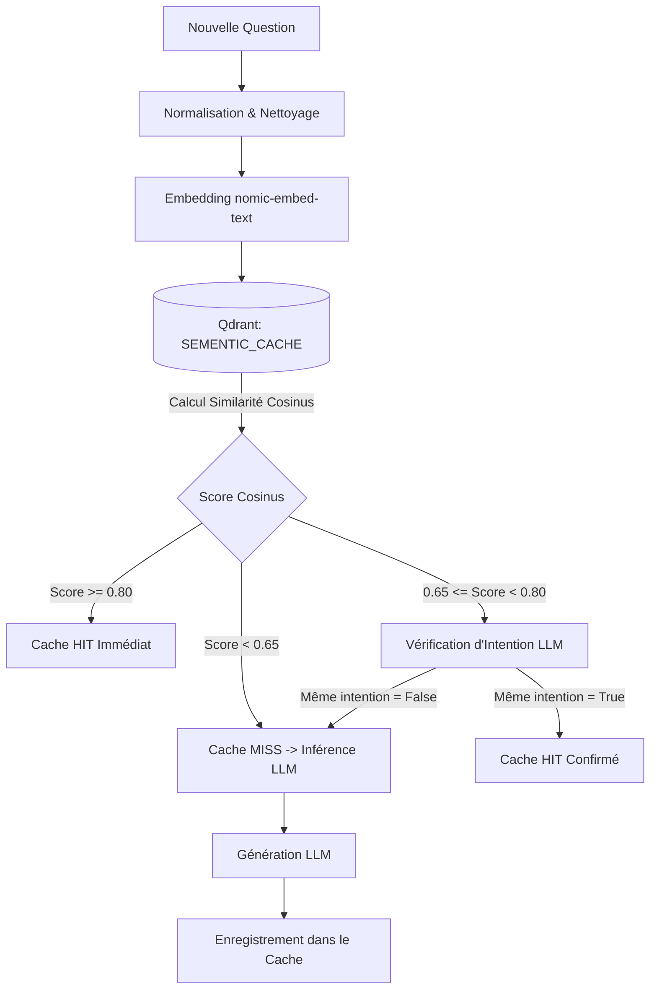

SensAI intègre deux sous-systèmes vectoriels haute performance propulsés par la base de données vectorielle **Qdrant** et le modèle d'embeddings local **`nomic-embed-text`**.

---

## 📚 Le Système RAG (Retrieval-Augmented Generation)

Le RAG permet à l'agent de fonder ses raisonnements sur des archives historiques authentiques issues de la période des Royaumes Combattants :
- **Shiji (Mémoires Historiques)** de Sima Qian (Annales des Cinq Empereurs, biographies de Bian Que, maisons héréditaires).
- **Zhan Guo Ce (Stratégies des Royaumes Combattants)** (Qin Ce, Qi Ce, Chu Ce, Zhao Ce, Wei Ce, Han Ce, Yan Ce).
- **L'Art de la Guerre** de Sun Tzu.


### 1. Ingestion et Vectorisation (`src/RAG/RAG_embedding.py`)

Les chroniques sont découpées en fragments sémantiques (*chunks*) avec chevauchement (*overlap*) pour conserver le contexte narratif :
- Taille d'embedding : **768 dimensions**.
- Métrique de distance : **Cosinus**.
- Métadonnées associées à chaque point : nom du chapitre, royaume concerné, personnages mentionnés et numéro de section.

Pour initialiser ou rafraîchir la base vectorielle locale :

```bash
python -m src.RAG.RAG_embedding
```

### 2. Recherche Hybride et Reranking (`src/RAG/retriever.py`)

Lors de la requête :
1. **Extraction d'entités :** Le système extrait les royaumes et personnages clés mentionnés dans la question.
2. **Recherche dense (Dense Search) :** Recherche par similarité cosinus sur les vecteurs d'embeddings.
3. **Recherche lexicale (Sparse / Keyword Search) :** Recherche par correspondance exacte des noms propres historiques.
4. **Fusion & Repli Web :** Si moins de deux sources pertinentes sont trouvées dans les chroniques locales, le système déclenche automatiquement une recherche web complémentaire pour enrichir le contexte sans halluciner.

---

## ⚡ Le Cache Sémantique (`src/core/sementic_cache.py`)

Le cache sémantique évite de solliciter le LLM pour des questions redondantes ou reformulées, réduisant le temps de réponse à moins de **15 millisecondes**.

### Architecture Multi-Niveaux



### 1. Normalisation du Prompt (`normalize_prompt`)
Supprime les formules de politesse et mots de remplissage conversationnels (*"peux-tu m'expliquer"*, *"can you please tell me about"*, etc.) afin de comparer le cœur sémantique de la requête.

### 2. Seuil Haut de Validation Directe (`seuil_haut = 0.80`)
Si la proximité cosinus entre la question en cache et la nouvelle question dépasse 0.80, la réponse mise en mémoire tampon est renvoyée instantanément avec l'indicateur `from_cache: true`.

### 3. Palier Intermédiaire & Validation d'Intention (`seuil_bas = 0.65`)
Pour les questions proches mais ambiguës (ex: comparaison entre deux généraux ou variantes orthographiques), un sous-appel LLM ultra-léger vérifie la stricte équivalence d'intention au format JSON strict :

```json
{"same_intent": true}
```

Si l'intention est équivalente, le cache est validé ; dans le cas contraire, une nouvelle inférence est déclenchée.
