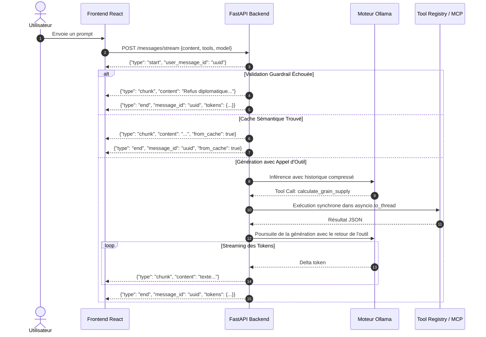

Ce document détaille les mécanismes internes de communication entre le frontend React et le backend FastAPI de SensAI, notamment le protocole de streaming NDJSON, les formulaires dynamiques, le mécanisme *Human-in-the-loop*, et la compression de mémoire.

---

## ⚡ Protocole de Streaming NDJSON (`/messages/stream`)

La communication conversationnelle s'appuie sur une requête HTTP `POST` envoyée à `/api/conversations/{id}/messages/stream` renvoyant une réponse au format `application/x-ndjson` (Newline Delimited JSON).

### Cycle de Vie d'un Échange en Streaming



### Types d'Événements du Flux

1. **`{"type": "start", "user_message_id": "<uuid>"}`** : Notifie la prise en charge de la requête et l'identifiant du message utilisateur enregistré.
2. **`{"type": "chunk", "content": "<texte>"}`** : Morceau de texte généré à concaténer à la bulle de discussion en cours.
3. **`{"type": "end", "message_id": "<uuid>", "prompt_tokens": 120, "completion_tokens": 45, "total_tokens": 165}`** : Clôture du flux, fournissant l'identifiant final et les métriques de tokens.

---

## 📋 Formulaires Dynamiques Interactifs (`ask_user_form`)

Lorsque le modèle estime qu'il lui manque des paramètres indispensables pour exécuter une tâche (ex: armée cible, durée de campagne, nom de manuscrit), il émet un appel à l'outil interne `ask_user_form`.

### Format du Bloc Délimité

Le backend sérialise cet appel sous un bloc de code spécial markdown :

````markdown
```sensai-form
{
  "title": "Préparation de l'expédition militaire",
  "fields": [
    {"name": "kingdom", "label": "Royaume Cible", "type": "select", "options": ["Qin", "Zhao", "Chu"]},
    {"name": "soldiers", "label": "Effectifs mobilisés", "type": "number", "default": 100000}
  ]
}
```
````

### Rendu Côté Frontend

Le composant de message dans le frontend intercepte les blocs de langage `sensai-form` et rend dynamiquement un formulaire interactif accessible :
- Les champs sont modifiables par l'utilisateur.
- À la soumission, les réponses sont formatées et renvoyées automatiquement comme message utilisateur suivant sous la forme :
  `[Formulaire complété] {"kingdom": "Zhao", "soldiers": 100000}`.
- L'IA reprend alors son raisonnement avec les paramètres exacts fournis par l'humain.

---

## 🛡️ Human-in-the-Loop & Confirmation Sécurisée (`sensai-confirm`)

Les outils ayant un impact persistant sur le disque ou les données sont classés comme **actions destructives** :
- `write_manuscript_file` (création ou écrasement de fichier markdown).
- `update_kingdom_database` (mise à jour directe SQL de la base `kingdoms.db`).

### Mécanisme de Verrouillage par Token Éphémère

1. **Détection :** Lorsque le modèle appelle un outil destructif, le backend n'exécute pas l'action immédiatement.
2. **Séquestre :** Le backend génère un `action_id` aléatoire sécurisé (token cryptographique éphémère) et stocke les arguments exacts en mémoire (`_pending_actions`).
3. **Bloc `sensai-confirm` :** Le backend émet un bloc formaté :
   ````markdown
   ```sensai-confirm
   {
     "tool": "write_manuscript_file",
     "action_id": "sec_tok_9f8a3b12",
     "summary": "Écriture dans le manuscrit 'chroniques_qin.md' (340 caractères)"
   }
   ```
   ````
4. **Validation Utilisateur :** Le frontend affiche un panneau de validation explicite avec deux boutons : **Approuver** ou **Refuser**.
5. **Déverrouillage :** Si l'utilisateur approuve, la requête suivante renvoie `approval_token: "sec_tok_9f8a3b12"`. Le backend vérifie l'authenticité du jeton, retire l'action en attente et l'exécute avec les arguments vérifiés.

---

## 🧠 Gestion du Budget de Tokens & Compression Sémantique

Afin de ne pas saturer la fenêtre de contexte des modèles locaux (`qwen2.5` ou `llama3`), le backend intègre un gestionnaire de budget de tokens (`memory_management.py`) :

- **Plafond configurable :** Par défaut, un budget maximal de contexte historique est fixé (`HISTORY_TOKEN_BUDGET = 4000` tokens).
- **Compression automatique :** Lorsque l'historique dépasse ce plafond, les messages les plus anciens sont extraits et synthétisés en arrière-plan par un sous-appel LLM concis.
- **Préservation des rôles récents :** Les 3 à 5 derniers tours de discussion sont conservés intacts pour garantir la pertinence immédiate, tandis que le passé lointain est résumé en tête d'historique sous forme de résumé mémoriel contextuel.
